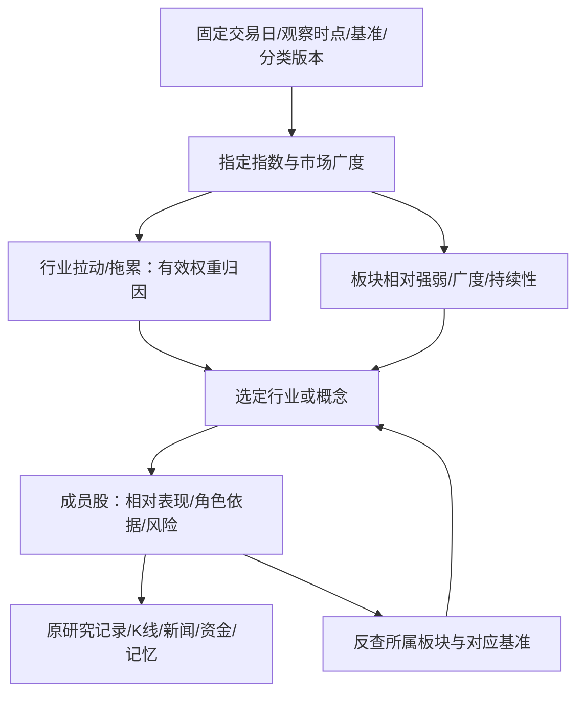

# 大盘—板块—个股联动：现状审计与统一设计

日期：2026-11-14。审计基线：`dev@0cc2228c922082a1eecf7478942cf6532a7aebbc`。用户要求理清哪个板块推动/拖累大盘，哪个板块带头，板块内谁领先、谁跟随、谁弱势，并寻找适合现有工程的方案。

**状态：方案与现有代码审计；以下新增归因、角色、分时联动均未实现。** 本次没有改运行代码、正式评分、策略权重、账户、主页或生产发布。91项既有专项回归通过，只证明原模块契约，不能当作本方案的验收。

## 1. 要分别回答的三个问题

| 用户问题 | 需要的证据 | 应给出的结果 |
| --- | --- | --- |
| 哪些板块把大盘拉上去/拖下去？ | 指定指数的有效成分、适用权重、价格及调整规则 | 行业贡献百分点/点数、覆盖率、未归属和对账残差 |
| 谁是真强、谁只是少数大票撑着？ | 板块收益、同窗基准、完整成员行情与广度 | 相对强弱、普涨/集中上涨、持续/转弱、样本范围 |
| 谁带头、谁跟随、谁弱势？ | 个股相对板块与市场表现、成交参与、连续观测；先后顺序另需分时证据 | 趋势前排/空间前排/成交核心/跟随观察/弱势或未知，并列依据 |

这三者分别是**指数归因、横向强弱、时间上的领先跟随**。板块涨得最多，不必然对某指数贡献最大；某股涨得最多，也不必然带动了同板块其他股票。资金净额是另一种供应商统计，不能代替任何一列。

## 2. 仓库已经有什么，缺什么

以下路径相对 `V6_BO/`；行号以审计基线为准。

| 实际代码 | 已有能力 | 本次发现的限制 |
| --- | --- | --- |
| `src/strategy/daily-sector-strength.js:16` | 同日板块收益、上涨比例、中位数、前两只正涨幅集中、可选涨停扩散；行业/概念分开排名 | 至少5有效股、80%覆盖是研究显示门槛；不能证明完整历史成分或官方指数贡献。已有综合分是未验证启发式 |
| `src/strategy/market-sector-resilience.js:21` | 至少两核心指数与广度判断广泛上涨/下跌，观察板块逆势、抗跌、落后 | 采用几个指数均值作研究比较；均值不是某个可复制的官方指数，不能当指数归因基准 |
| `src/strategy/linked-factor-research.js:39` | 21个对齐交易日计算20日板块超额市场、个股超额板块 | 导入研究；没有完整的分时启动先后证据，价格及历史可得性仍需另外核验 |
| `src/strategy/sector-relations.js:51` | 同来源/分类/成员连续记录的相关、去市场相关、成员重叠、3/5日资金方向 | 已明确相关不等于因果、反向净流不等于资金从A转入B；不能直接升级为带动关系 |
| `src/core/sector-relations-capture-bridge.js:64`、`sector-member-identity-proof.js` | 重放已有采集、冻结成员身份、日历及来源指纹 | 现有采集桥使用等权成分代理，不是官方行业指数或指数成分权重；冻结不能认证历史真实可得性 |
| `src/strategy/sector-rotation-history.js:13` | 3/5个显式交易日的广度与强度升降 | 历史对比需同时复用成员身份证明；只比较人数相同不能证明成员相同；不能把日变化称盘中先涨后跟 |
| `src/core/research-workspace-analytics.js:10` | 封存板块/同日个股位置，标相对前排、中段、后排，保留历史时点 | 已说明不认证龙头；不是全市场主线判断；选择多个板块时不应把其中第一个角色冒充唯一总体角色 |
| `server.js:15749`、`5752`、`5861` | 旧 `classifySectorRoles` 以候选池连板高度/成交额排龙头、龙二、中军、跟风；被若干既有评分消费 | 非空池会选出一个leader，剩余股票分配角色；池可能只是涨停股及部分强势股。它不证明全板块完整排名或真实带动性；不能无验证地换成新分数 |
| `public/assets/research-context.js`、`research-workspace.js:149` | #234已完成股票跨六分区带入、明确读取；已有板块位置展示 | 当前上下文以股票为中心，尚未统一指定指数、板块身份与观察窗口。按代码市场筛选不等于指数成分筛选 |

结论：复用现有研究、封存和取消机制。真正缺口是有效权重归因、跨模块统一的指数/板块/时间身份、可解释的持续领先与跟随证据。另起一个排行榜或再堆一个总分不能补齐这些缺口。

## 3. 大盘：先定基准，再算行业拉动与拖累

每次明确选择一个基准，例如上证综指、沪深300或创业板指，各用自身方法和成分，显示代码、价格/全收益口径、日期与时点。可以并列多个基准，但不能把它们平均后称作其中一个。市场广度另显示全市场范围，避免将沪深300成分广度冒充全部A股广度。

在同一个收益区间内，若成分、调整股数和除数无变化，且使用适用的起点有效权重，个股单期贡献为 `c_i = w_i,0 × r_i`，行业贡献为本指数成员中该行业 `c_i` 的和。`r` 为小数收益，`100 × c` 为百分点；贡献点数为 `I_0 × c`。归因使用指数规则适用的调整价格/股数和除数；只有月末权重时只能报权重近似，不能报精确点数。

- 优先输出拉动/拖累点数与百分点。涨幅榜、成交额榜、贡献榜分别展示；指数不含某股时，该股对这个指数的直接贡献是0，不能凭题材热度分配贡献。
- 有调样、除权、股本/权重调整、停牌或特殊估值规则时，按该指数方法切分归因区间并对账。停牌成分按官方估值规则处理，不能删除后把其余成分重新归一化。多期贡献不能直接相加，须使用明确的链式归因方法。
- 逐期使用一致单位对账：收益小数残差为 `R_index − Σc_i`，点数残差为 `ΔI − I_0 × Σc_i`，不能把点数直接减收益小数。连同缺价、未归属行业、未获权重和调整项报告；调整日先按同口径分段再对账。对账容差在实现前按方法/精度确定并固定；未满足完整输入/对账条件时显示“部分估算”，不认证精确归因。
- 用同一分类体系、同一级行业，把每只成分放入一个已核验行业或“归属未知”，形成可加总分区。概念可以多重归属，单独展示关联；不能把多个概念的贡献加成市场总贡献，也不默认平均分摊成“精确贡献”。
- 指数收益接近0时不给贡献占比，避免分母接近0造成巨大误导；正负贡献均保留，不把上涨板块贡献强行归一到100%。

算术例子，**非实际行情**：起点1000点，行业A权重40%、收益+3%，行业B权重60%、收益−1%；在上述无调整条件下分别贡献+12点和−6点，指数净涨6点。行业A涨3%并不意味着它把整个指数拉高3%。

无有效指数权重时仍可提供“同窗涨跌、相对表现、上涨家数和等权样本代理”，明确标注其口径，保留归因缺失；不按总市值、成交额或资金净额冒造精确指数贡献。

## 4. 板块：贡献、强度和持续性并列

1. **贡献**：取第3节，不与相对强弱综合打分。
2. **相对强弱**：同窗板块收益减基准收益，分别看当日、5日、20日；每个窗口有自己的起止时点。收益与复权口径必须兼容，不能拿盘中板块与收盘指数、未复权股价与全收益基准混算。多日用复合收益，不能累加每日百分数。
3. **内部参与**：上涨数/有效交易成员数、中位数收益、下跌/平盘/停牌/缺价数、有效覆盖率。另可显示 `(涨家数−跌家数)/有效交易成员数`，这是定义明确的标准化广度，和原上涨比例、累计AD线区别命名。平盘进入有效分母，停牌/缺价另列，缺失不填0。
4. **集中与扩散**：复用现有前两名正涨幅集中指标，但标作等股票涨幅集中度；另有真实权重时才能展示市值贡献集中度。去掉最强1/2只后的成员中位数、上涨比例用于判断是否仅少数票拉升，分母和剔除对象必须可展开。
5. **持续性**：同一成员身份及可比时段的3/5个交易日强弱、广度与排名变动；成员变化分段显示。当前名单不能回填过去；未知日不跳过并称连续。隔夜与盘中状态分开。

| 观察组合 | 允许的描述 | 不能直接得出的结论 |
| --- | --- | --- |
| 指数涨，板块涨且广度扩散 | 同向走强；有有效贡献数据时另列实际拉动 | 自动认定该板块是指数上涨原因 |
| 指数跌，板块涨 | 逆势上涨；若属于指数，可抵消部分跌幅 | 大盘整体已经转强 |
| 指数跌，板块也跌但更少 | 相对抗跌，同时明确绝对亏损 | 把抗跌标成上涨或买点 |
| 指数涨，板块跌或多数成员跌 | 板块落后；可能出现指数与广度分化 | 将指数上涨称为全市场普涨 |
| 板块涨、中位数弱、涨幅集中 | 少数股集中上涨，扩散待确认 | 把单只强股认定为全板块共振 |

“主线候选”须同时展示同窗相对强弱、广度/中位数、连续性和有效范围；“补涨观察”还需此前落后与本期扩散证据。没有历史只能叫当期走强，不能叫主线、补涨或轮动已确认。阈值先沿用现有研究配置并明确版本，后续经冻结样本外检验再调整，不把研究分数转换为胜率。

## 5. 个股：角色是带范围和时间的证据，不是固定身份

同一股票可在不同行业/概念中处于不同位置，也可同时是成交核心与趋势前排。允许并列、并列第一、无明确龙头和证据不足；不能为每个池强行填满龙一/龙二/中军。

| 展示角色 | 拟采用的依据 | 缺证据时的处理 |
| --- | --- | --- |
| 趋势前排候选 | 同一板块有效成员中，5/20日相对收益位置及近几个交易日保持程度；个股相对板块和基准分别显示 | 只显示当期相对位置，不能用一日最高涨幅认证长期龙头 |
| 空间前排 | 已核验的实际连板高度、首次封板/回封记录、当时适用涨跌停规则 | 缺逐日价格限制、状态或事件时间就未知；不能默认所有股票10%限制 |
| 成交核心候选（中军观察） | 成交额及流动性在板块中的相对位置和持续性，同时看价格是否响应 | 大成交本身可能是分歧/抛压，不等于资金看好或带动力 |
| 先行/跟随观察 | 预先固定分时事件定义、相同分钟窗口和原始时间，先观察到A持续异动，后B异动；列启动时差及样本 | 只有日K只能标同步走强/非领涨；不编造启动先后 |
| 弱势/低参与度（对应用户说的“杂毛”） | 对板块和基准持续落后、反弹参与不足，或短脉冲后相对优势消失；另列流动性与风险 | 缺价、停牌、新股历史不足一律不归为弱势；不把没有涨停的票统一归为跟风 |

第一版应输出原始值、同类样本分母、百分位/并列位置、连续观测数、规则版本和不满足项；保留多维结果，不先人为编一个“带动力总分”。若以后使用前20%/连续3日等角色门槛，必须作为明确冻结的研究参数验证，不能把它写成市场规律。

个股相对板块建议同时列“含自身板块”与可计算时的“剔除自身成员参照”，防止大权重股票拉高板块又被同一板块确认的循环证据。剔除自身的参照只能依已知成员/权重重建，不能把官方板块指数简单减一个股涨幅；无法重建就标缺失。概念重叠的共同成分也须单独标出。

“先涨后跟”也只是顺序观察。若要声称领先关系具有稳定性，需要事前固定滞后/窗口，控制共同市场、行业和重叠成员，使用多个独立阶段样本外检验、校正多重尝试，报告样本数、效应、误差与失败阶段；不能从一张相关图得出因果或自动交易条件。新闻发布时间和被系统知道的时间分别保留，不能拿事后新闻解释当时已知原因。

## 6. 模块联动与页面呈现

在已有研究工作区做一条“基准 → 板块 → 个股”的查看链路，手机按层展开、电脑可并列；延续原配色、K线、证据和返回入口。两张锁定主页不改。先依赖现有合格证据，有缺口在所在层显示，不生成另一套候选中心。

- **选指数**：切换对应行业贡献与板块比较基准；“上海市场”这种代码前缀范围保留自己的名称，不能冒充上证综指或沪深300成分。
- **点板块**：带入提供方、分类版本、行业/概念、代码、观察时点与窗口；筛选成员股并展示普涨/集中程度。按实际成员身份过滤，不按名称包含关系猜归属。
- **点股票**：原K线、研究记录、新闻、资金、记忆定向联动，并保留指数与所选板块。反查其他所属板块时先展示列表，由用户选；不把第一个板块强行替换为主行业。
- **返回/切换窗口**：保留筛选、所选股及可比较的历史时点；某股不属于新板块时明确解除该关联，不静默换成另一股。历史研究版本继续绑定原run，不用最新市场证据补写旧解释。
- **旧回复、权限和隐私**：沿用#234世代/取消机制，指数/板块/时间变化使有关请求失效；多分区先完成上下文更新再发事件。选择和显式读取分离，绝不因选中对象自动采集、分析、下单或发通知。私有run、账户、令牌不进入公开链接。

建议新增研究上下文的设计字段：`benchmark{provider,code,methodologyVersion,returnBasis}`、`sector{provider,classificationVersion,category,code,membersHash}`、`symbol`、`tradeDate`、`asOf`、`window{start,end,interval}`、`evidenceIds`、`requestGeneration`。另保留原始`sourceTimestamp`、`retrievedAt`、`availableAt`与成分/权重`effectiveAt`和`knownAt`；不可用接收时间补原始报价时间。结果标清官方归因/权重近似/成分等权代理/未知。

## 7. 实施顺序与验收

内部依赖顺序如下，作为同一批需求集中实施/验证，不按每个参考仓库反复提交。

1. **先补身份与证据契约**：复用成员冻结、交易日历、原报价时点和档案，区分官方指数与代理、行业与概念；为上述三类问题分别列数据齐备度。未来观测、未来分类、未知公司行为不进入可比较历史。
2. **再做只读统一投影**：复用现有板块强度、相对收益、轮动和工作区；增加贡献计算的独立分支及缺失状态。按原始权重累计已知贡献，缺失不重归一；归属未知纳入对账。旧role与新`researchRoles`分别展示依据，新研究输出不写入旧score/正式权重。
3. **接现有研究页联动**：指数/板块/个股层层下钻，同一上下文和时钟，可恢复/清除；320/390/430/1536宽度、键盘、无溢出及迟到回复验证。新接口如有必要，继承现有只读/编辑权限和no-store，不旁路已有任务/资源限制。
4. **分时及稳定性最后补**：没有真实源时点、连续历史与可用成分/权重时保留未知；事前冻结研究参数，在未参与设计的阶段验证领先和跟随，再讨论是否影响原策略。原四策略、15秒报价门禁及账户机制另行验收，不能因研究分数越权。

验收必须覆盖：

- 同为+5%的板块因指数权重不同贡献不同；非指数成员不产生直接贡献；指数不涨但有正负抵消仍展示两边；极小净涨跌不算误导占比。
- 重叠概念、未知行业、同代码不同提供方/分类版本、成员相同数量但换股、调样日和除权日不出现重复归因或假连续。
- 一只股大涨其余下跌与普涨分开；剔除自身可发现自我确认；排名并列和小样本不强行产生龙头，缺数据不变成弱势。
- 只有日线不生成先涨后跟；盘中不同分钟/不同数据时钟、停牌、未知限价、跨日与休市快照不当成当前行情；周末保留最后交易日并允许新新闻另更新。
- 选板块/股票、切窗口、返回、同股历史版本、旧请求迟到、撤权和离线均保持身份一致；联动选择零交易/通知/采集写请求；对旧策略和账户输出做前后对照。

## 8. 本次查阅依据与实际验证

[来源指纹和范围](MARKET_SECTOR_STOCK_LINKAGE_SOURCES_20261114.json)记录4份实际HTTP 200的原文及1个固定提交的开源文件/许可。网页/PDF的出版或修订日期未核实；2026-11-14为查阅日，不代表内容发布日。

- [CSI沪深300方法](https://oss-ch.csindex.com.cn/static/html/csindex/public/uploads/indices/detail/files/en/000300_Index_Methodology_en.pdf)：4.2与5.1说明调整股数、除数维护。仅适用于其对应方法，不能泛化为所有指数都用同一权重。
- [StockCharts相对轮动说明](https://chartschool.stockcharts.com/table-of-contents/chart-analysis/chart-types/relative-rotation-graphs-rrg-charts)：借鉴相对基准、强度与变化分开；自己计算的收益差/变化不得冒称JdK或完整RRG指标，也不保证轮动方向。
- [StockCharts市场广度](https://chartschool.stockcharts.com/table-of-contents/market-indicators/advance-decline-line)：票数广度与市值加权指数回答不同问题。
- [QuantConnect研究指南](https://www.quantconnect.com/docs/v2/writing-algorithms/key-concepts/research-guide)：使用当时可得成员与数据，防幸存者/前视偏差。简单延迟不能补回根本不存在的历史成员。
- [AKShare行业源码](https://github.com/akfamily/akshare/blob/ab94ddf63d2ef4aa9561b4c512ea4c17e729b204/akshare/stock/board/stock_board_industry_em.py)：实读1–225行及MIT许可，核对上涨/下跌家数与供应商领涨股票字段；这些字段不含可据以认证指数贡献的有效权重。未安装SDK、复制代码、请求真实行业行情或证明历史名单完整性。软件许可和行情使用/再分发许可分别处理。

本次仅运行10份既有模块专项：**91项通过、0失败、0跳过**，命令和日志见来源JSON。只做文档和交接记录，没有运行新增算法、全量回归、浏览器或生产验收，不将上一批#234的3568项回归视作本设计已实现。完整方案及来源文件留作下一批集中代码工作的依据；当前没有新增PR或远端发布。
