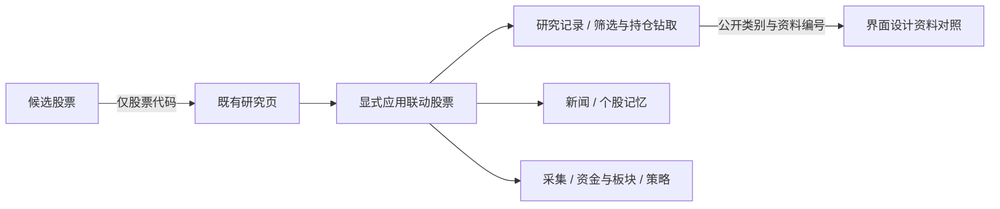

# 界面参考与股票分区联动统一采用记录

用户要求多找仓库、界面与模块联动参考，再集中修改、测试、提交，避免零碎迭代。基线为 `dev@040692bcea3039cd707e1b7f52b5ad08ee77ebd2`。本轮先完成 12 个新增独立项目的官方源码/许可核查，再落实一批现有页面之间的实际流程；原 41 项资料保持，统一目录现为 **53 个公开来源**，不是 53 个已接通模型。

## 参考与取舍

固定提交、已读源码、文件指纹和许可分别见 [A组证据](UI_RESEARCH_SOURCES_A_20261114.json)、[B组证据](UI_RESEARCH_SOURCES_B_20261114.json)，详细机制见对应两份 `UI_RESEARCH_NOTES_*`。没有安装或执行上游、复制其组件/样式/品牌、增加框架依赖或收费 API。

| 目录 ID | 新项目 | 本轮比较的机制 | 采用状态 |
| --- | --- | --- | --- |
| U01 | [Perspective](https://github.com/perspective-dev/perspective) | 主/详情选择、瞬态过滤与保存配置分开 | 参考 |
| U02 | [FDC3](https://github.com/finos/FDC3) | 证券上下文与明确查看意图区分 | 独立实现股票上下文与分区入口；未实现 FDC3 标准/代理 |
| U03 | [Grafana](https://github.com/grafana/grafana) | 上下文链接、时间与变量范围、取消过时意图 | 参考，不复制 AGPL 组件 |
| U04 | [AG Grid Community](https://github.com/ag-grid/ag-grid) | 明确选择来源、键盘可达、选择与过滤分开 | 参考，仅 Community；不使用商业 Enterprise 主从表 |
| U05 | [Glide Data Grid](https://github.com/glideapps/glide-data-grid) | 详情选择与多选比较分别操作 | 参考 |
| U06 | [Apache Superset](https://github.com/apache/superset) | 按来源作用域清除联动，不误清无关设置 | 独立实现分区失效清理与定向输入更新 |
| U07 | [TanStack Table](https://github.com/TanStack/table) | 稳定选择身份与筛选、分页可见集分开 | 参考；保留已有 #233 同股/版本连续性 |
| U08 | [TanStack Router](https://github.com/TanStack/router) | 受控 URL 参数、清除优先于保留 | 独立实现公开对照链接及清除后刷新不复活选择 |
| U09 | [Apache ECharts](https://github.com/apache/echarts) | 带身份的事件/动作、抑制联动回路 | 独立实现股票事件单向消费；未引入图表库 |
| U10 | [Metabase](https://github.com/metabase/metabase) | 区分筛选、跳转、重置；缺目标不替换成其他对象 | 参考，不复制 AGPL/商业组件 |
| U11 | [Plotly Dash](https://github.com/plotly/dash) | 触发来源、输入/输出依赖与循环边界分开 | 参考 |
| U12 | [Streamlit](https://github.com/streamlit/streamlit) | 控件身份、导航恢复范围、失效与禁用保护 | 参考；会话状态不代替云端档案 |

FDC3 规范根许可为 CSL 1.0，而本次读取的 `@finos/fdc3-standard` 代码明确 Apache-2.0，不能笼统标成 MIT。Grafana 所读 dashboard 代码为 AGPL；Metabase 区分 AGPL 和 enterprise 商业目录；AG Grid Community 与 Enterprise 分别授权。源码、第三方资产、数据/地图、服务和品牌授权各自独立，本轮只独立采用通用设计原则。

## 一批落实的流程

### 候选股带入同股研究

以前每只候选都跳到相同的 `/research.html#decisionWorkspace`，丢失股票身份。现在仅通过校验过的六位代码进入既有 `/research.html?symbol=…#researchWorkspace`。坏代码回到普通研究入口，不拼入参数；令牌、账户、私有研究版本和历史时点不进入链接。

到达后仅预填，不自动读取、采集、分析、下单或发送消息。没有新增首页、另一套选股结果中心或第二后台。

### 同一股票的六个现有分区

新增小型股票联动条，覆盖研究记录、新闻证据、个股记忆、日K与采集、资金与板块、策略研究。应用股票时先完成所有相关代码输入，再发出输入失效事件；同股/同来源不重复触发输入清理，保留已有选中研究版本。

“应用股票”是明确的整体带入动作；点击单个分区入口只更新该分区并滚动/聚焦，不覆盖其他手工草稿。清除联动股票只清仍等于该股的输入，保留不同股票草稿、原筛选批次及历史时点。界面称为“联动股票”，不会把独立修改的所有分区都称作同一当前结果。

历史研究时点保持原值；新闻、个股记忆和采集按各自证据日期查看，提示不能把新资料当旧记录证据。仅在内存维护公共代码和可选来源，不使用浏览器存储、令牌 URL 或跨域广播。

### 筛选/持仓中的实际研究钻取

在筛选与落选行、持仓防守项中增加“查看该股研究”。只有明确点击才用现有只读工作区 GET 读取，保留原批次和历史时点，回到第一页证据视图。换股清除旧版本/对照，保持同股则保留原选中版本；找不到该股记录时由原 API 显示缺失，不偷偷换成其他股票。

### 公开设计对照可恢复、可清除

研究诊断中保留原全部资料库入口，并增加相关界面联动对照入口。资料库支持经过白名单验证的类别、采用状态和最多三个已知目录编号；目录验证通过后才解析实际选择。

“公开视图链接”及浏览器地址只包含这些公开字段，不包含自由搜索词、证券研究 ID、账户、令牌、时间或预测。用 `replaceState` 更新当前公开地址，不增加历史条目；清除后刷新不能复活已清除的选择。请求失败/坏目录/重试会清理旧选择和链接，不能从失败前的 URL 自动恢复。

## 联动前必须补的失效保护

原个股记忆/公共资金面板只检查令牌，没有完整的换股世代校验。新增按 public、analysis、memory 三个分区分别管理的取消控制、输入快照和世代标识：

- 换股、改公共日期/板块、换文件或保存选项只清有关输出；公共上下文变化同时清依赖它的分析，不清独立记忆结果。
- 改身份、页面隐藏/离开、离线、401/403 或明确密码门禁会清理这三个分区的私有结果，迟到回复不能重新显示。
- 旧请求结束不能解锁或清空另一个较新请求；超时恢复相应按钮。
- 文件异步读取后再次校验，旧文件不会在输入变化后发出 POST。
- 公共请求返回时可能已有一个“不含新公共上下文”的分析在运行；接受新公共证据前先清理/取消该分析，并检查分析捕获的公共上下文引用，避免新旧证据混显。

所有原来的分析/保存动作仍由用户原按钮触发。取消客户端展示不等于撤销用户先前已明确发出的后台保存；没有修改原账本、权限、四套策略、真实报价时点或 15 秒规则。

## 验证、提交和恢复

实际验证记录见 [UI_LINKED_WORKFLOW_VALIDATION_20261114.json](UI_LINKED_WORKFLOW_VALIDATION_20261114.json)。新增两份浏览器脚本已接现有 UI CI，保留既有研究/选股/预测检查。320/390/430/1536 CSS 视口使用明确合成记录，另读实际 53 来源目录；检查键盘、44px 控件、无横向溢出、零联动写请求、跨股迟到回复、同股版本保留、批次/历史时点、公开链接与清除后刷新。手机/桌面截图已实际查看。

本地集中完整回归之后，独立关键代码复核发现并修正公共上下文返回竞态，追加专项和公开链接刷新用例；最终精确提交的完整门禁以 PR CI 为准，不把原测试数写成新增用例已被同一次旧全量执行。没有重复安装上游、分批提交或按候选逐次做全量回归；简单目录整理使用轻量模型，异步/权限关键代码使用代码模型定向复核。

两张锁定主页及其公用样式没有修改，资源使用内页自己的 `20261114context1` 版本，不改变全局 APP 协议。没有生产发布、真机 iOS/Android 认证、行情授权或收益认证。基线完整备份 `/workspace/scratch/ui-linked-baseline-040692b.tar`，SHA-256 `2ce8948f28bade3936509be4c05ece631721d7fdbab02ca06bb2a22434916c85`；回滚只 revert 本批提交，保留账户、研究档案、原始发行版和所有已有源码。
